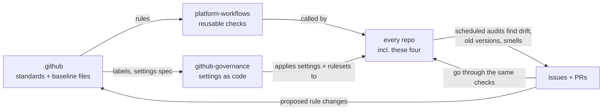

# Governance: how everything stays checked and current

A check that only runs when someone opens a PR stops protecting a repo once nobody
is opening PRs. Dependencies get CVEs, actions publish new versions, standards move
on, and settings get clicked away. So every rule here is re-checked **on a schedule
as well as on change**, and every finding comes back as an issue or a PR that goes
through the same checks as human work.

The system manages itself, including the repos that define it.

## The loop

- **`.github`** holds the written rules and the **baseline files** every repo must
  contain identically (`.gitattributes`, `.editorconfig`, base ruff/pyright config,
  pre-commit config, `opencode.json`).
- **`platform-workflows`** holds the checks. Its own PRs run its own checks.
- **`github-governance`** holds every repo's settings, rulesets and labels as
  Terraform, including the ruleset that protects `github-governance` itself.
- **Every repo** calls the platform checks on PRs and on a schedule.

Changing the system means a PR to one of these repos, reviewed and checked like any
other change.

## Cadences

| When | What runs | Where findings go |
|---|---|---|
| Every PR | PR title, lint, format, types, tests + coverage, Sonar quality gate, CodeQL, dependency review, secret scan, workflow lint (actionlint + zizmor), repo conformance, AI review (advisory) | PR checks and comments |
| Every PR to `github-governance` | `terraform plan`, posted as a PR comment | PR comment |
| Merge to `main` | release-please, `terraform apply`, image build and deploy (when CD lands) | releases, deploy status |
| Nightly | full CI on `main`, vulnerability scan of the lockfile (pip-audit), Terraform drift check | issue labelled `governance` |
| Weekly (Monday) | Dependabot (14-day cooldown), baseline file sync, pre-commit hook updates, CodeQL full scan, OpenSSF Scorecard, AI health audit of the whole codebase, stale issue/PR sweep | PRs, one "Weekly health report" issue per repo |
| Monthly (1st) | AI review of the handbook against current tools and real practice, access review (collaborators, apps, deploy keys, secrets ages) | PR to `.github`, issue in `github-governance` |
| Weekly (after audits) | fleet summary: open governance issues, failing scheduled runs, Scorecard and Sonar scores per repo | pinned "Fleet health" issue in `github-governance` |

Scheduled jobs never fail silently: a failing schedule opens or updates an issue.

## Staying current

- **Dependencies and actions:** Dependabot in every repo for `uv`, `github-actions`,
  `docker` and `terraform`, weekly, with a **14-day cooldown** so brand-new releases
  (the usual window for compromised packages) aren't picked up. Patch and minor updates
  auto-merge once all checks pass. Majors wait for a human.
- **Pinned SHAs** are updated by Dependabot, which rewrites the SHA and the version comment.
- **Reusable workflows:** repos pin full release commit SHAs with version comments.
  Dependabot proposes platform release updates, including majors, as reviewed PRs.
  Reverting the caller pin restores the previous known platform implementation.
- **Pre-commit hooks:** a weekly job runs `pre-commit autoupdate` and opens a PR.
- **Baseline files:** a weekly job copies `.github/baseline/` into each repo and opens
  a PR if anything differs. Editing a baseline file in one repo directly gets
  reverted by the next sync, unless the repo is listed as an exception.
- **The standards themselves:** a monthly AI pass proposes handbook updates as a PR.
  A human merges or closes it.

## Settings as code

Repo settings, rulesets, labels, security features and environments are defined in
`github-governance` (Terraform with the `integrations/github` provider). Editing them
in the GitHub UI counts as drift: the nightly plan reports it, and the next apply
reverts it. To change a setting, open a PR there.

Break glass: the account owner can still disable a ruleset in the UI during an
incident. Doing so opens a drift issue the next night, and that issue stays open
until the code and reality match again.

## Bots and tokens

| Identity | Permissions | Used for |
|---|---|---|
| `GITHUB_TOKEN` | per job, least privilege | all normal checks |
| automation GitHub App | contents, pull requests, issues: write | baseline sync, hook updates, release-please, AI fix PRs (PRs from an App trigger CI; PRs from `GITHUB_TOKEN` don't) |
| governance GitHub App | administration: write, plus the above | Terraform in `github-governance` only |
| AI API key | none on GitHub | AI review, audit and fixes |

No personal access tokens. App private keys and the AI key are repository secrets,
rotated every 90 days. The monthly access review checks their age.

## AI in the loop

The same AI runner, configured once in the baseline `opencode.json`, does:

- **PR review:** advisory comments on every PR.
- **Weekly audit:** reads the whole repo against this handbook and the repo's
  `AGENTS.md` glossary, and reports duplication, inconsistent names, dead code, stale
  docs and missing tests in the weekly health report.
- **Fix PRs:** at most one per repo per week, labelled `ai-generated`, through the
  normal checks and review.
- **Monthly standards review:** proposes handbook changes.

It runs anywhere the key is in the environment: GitHub Actions, a laptop, a server.
See [AI](ai.md).

Remote workflow pinning follows [ADR 0003](../docs/decisions/0003-pin-controlled-workflow-releases.md).
