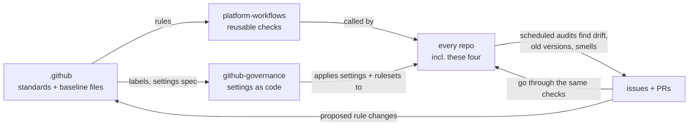

# Governance: how everything stays checked and current

A check that only runs when someone opens a PR stops protecting a repo once nobody
is opening PRs. Dependencies get CVEs, actions publish new versions, standards move
on, and settings get clicked away. So every rule here is re-checked **on a schedule
as well as on change**, and every finding comes back as an issue or a PR that goes
through the same checks as human work.

The system manages itself, including the repos that define it.

## The loop

- **`.github`** holds the written rules and the **baseline files** every repo must
  contain identically (`.gitattributes`, `.editorconfig`, base ruff/pyright config,
  pre-commit config, `opencode.json`).
- **`platform-workflows`** holds the checks. Its own PRs run its own checks.
- **`github-governance`** holds every repo's settings, rulesets and labels as
  Terraform, including the ruleset that protects `github-governance` itself.
- **Every repo** calls the platform checks on PRs and on a schedule.

Changing the system means a PR to one of these repos, reviewed and checked like any
other change.

## Activation and evidence

The cadence table is the target architecture. Deterministic CI/security checks and
native scanning are active; the initial verified checks were enforced by a bounded
operator bootstrap. Conformance passes on all four repos, and shortlink's first
container release has verified public provenance/SBOM. Additional required contexts
are reviewed desired state, awaiting hosted-state migration and the governance App.

HCP/App reconciliation, Sonar analysis, maintenance App PR creation across the
fleet, access metadata and live deployment must not be described as active until
configured and verified.
Missing setup skips explicitly. Three read-only fleet reports run live in
`github-governance` today: the weekly dependency inventory, the daily fleet health,
and the monthly access review. On the workflow token, the access review marks
admin-only sections as skipped. There is currently no hosted settings drift
coverage or automatic apply. Dependabot version/security PR creation works without
maintenance App credentials. Auto-merge stays disabled pending a safe, verified
main-context controller; generated titles may need normalization during review.

## Target cadences

| When | What runs | Where findings go |
| --- | --- | --- |
| Every PR | PR title, lint, format, types, tests + coverage, Sonar quality gate, CodeQL, dependency review, secret scan, workflow lint (actionlint + zizmor), repo conformance, AI review (advisory) | PR checks and comments |
| Every PR to `github-governance` | `terraform plan`, posted as a PR comment | PR comment |
| Merge to `main` | release-please, `terraform apply`, image build and deploy (when CD lands) | releases, deploy status |
| Nightly | full CI on `main`, vulnerability scan of the lockfile (pip-audit), Terraform drift check | issue labelled `governance` |
| Weekly (Monday) | Dependabot (14-day cooldown), baseline file sync, pre-commit hook updates, CodeQL full scan, OpenSSF Scorecard, AI health audit of the whole codebase, stale issue/PR sweep | PRs, one "Weekly health report" issue per repo |
| Monthly (1st) | AI review of the handbook against current tools and real practice, access review (collaborators, apps, deploy keys, secrets ages) | PR to `.github`, issue in `github-governance` |
| Weekly (Monday 06:30) | dependency inventory: every pinned dependency and upstream project, with archive status, last push and newest release | "Dependency inventory" issue in `github-governance` |
| Daily (06:45) | fleet summary: public repos missing from `repos.yaml` (unmanaged), required files and platform-workflows callers, live vs desired required checks, failing latest runs, open governance issues, open PRs, Scorecard score per repo | "Fleet health" issue in `github-governance` |

Scheduled jobs never fail silently: a failing schedule opens or updates an issue.

## Staying current

- **Dependencies and actions:** Dependabot in every repo for `uv`, `github-actions`,
  `docker` and `terraform`, weekly, with a **14-day cooldown** so brand-new releases
  (a common window for compromised packages) are deferred. Security updates do not
  wait for that version-update cooldown; they still pass normal checks and review.
  Patch/minor auto-merge is a gated target, currently disabled. Majors stay manual.
- **Pinned SHAs** are updated by Dependabot, which rewrites the SHA and the version comment.
- **Reusable workflows:** repos pin full release commit SHAs with version comments.
  Dependabot proposes platform release updates, including majors, as reviewed PRs.
  Reverting the caller pin restores the previous known platform implementation.
- **Pre-commit hooks:** native Dependabot monitors `/baseline` here weekly with the
  fourteen-day cooldown, retaining frozen SHAs and version comments. Conformance
  rejects mutable revisions. No custom hook updater or separate App key is needed.
  See [native ecosystem support](https://docs.github.com/en/code-security/reference/supply-chain-security/supported-ecosystems-and-repositories).
- **Baseline files:** a weekly job copies `.github/baseline/` into each repo and opens
  a PR if anything differs. Editing a baseline file in one repo directly gets
  reverted by the next sync, unless the repo is listed as an exception.
- **Upstream health:** Dependabot only says a newer version exists. The weekly
  dependency inventory also flags upstream projects that are archived, haven't been
  pushed to in a year, or are base images without a digest pin, so an abandoned tool
  gets replaced before it becomes a risk.
- **Baseline drift inside `.github`:** the `Baseline matches root` check fails any PR
  where a baseline file and the handbook repo's own copy differ.
- **The standards themselves:** a monthly AI pass proposes handbook updates as a PR.
  A human merges or closes it.

## Settings as code

Repo settings, rulesets, labels and security features are defined in
`github-governance` (Terraform with the `integrations/github` provider). Editing them
in the GitHub UI is a desired-state deviation. Once HCP/App setup is complete,
the nightly plan should report it and a reviewed apply should reconcile it.
Those hosted operations currently skip; a green setup check is not a drift audit. To change a setting, open a PR there.

Break glass: the account owner can still disable a ruleset in the UI during an
incident. Record the incident and restore protection promptly. Automatic drift reporting
requires the hosted credentials and is not currently available.

## Bots and tokens

| Identity | Permissions | Used for |
| --- | --- | --- |
| `GITHUB_TOKEN` | per job, least privilege | all normal checks |
| maintenance GitHub App (`BOT_APP_*`) | metadata read; repository-wide contents/PR/issues/workflows write capabilities | baseline sync, release-please and AI fix PRs through normal protection (App PRs trigger CI; `GITHUB_TOKEN` PRs do not) |
| enrollment GitHub App (`ENROLLMENT_APP_*`) | metadata read; contents/PR/workflows/secrets write | trusted public enrollment controller in platform-workflows |
| governance GitHub App | administration: write, plus the above | Terraform in `github-governance` only |
| AI API key | none on GitHub | AI review, audit and fixes |

The maintenance App implements the existing automation role; it is separate from
the enrollment and governance identities, not an additional automation App. It
was installed with owner approval on 30 October 2026.
Its credentials are configured in current public callers; the
[verified release run](https://github.com/Abdel-Abdelaal/platform-workflows/actions/runs/41056849315)
opened [App-authored proposal #88](https://github.com/Abdel-Abdelaal/platform-workflows/pull/88).
That proves proposal creation, not release publication, fleet rollout or successful
AI fix/baseline execution.

The release-please job in
[platform-workflows/release.yml](https://github.com/Abdel-Abdelaal/platform-workflows/blob/main/.github/workflows/release.yml)
authenticates as the maintenance App. The telemetry-version correction in
[platform proposal #89](https://github.com/Abdel-Abdelaal/platform-workflows/pull/89)
requests workflow-write in a token limited to that job's repository, to update
annotated version fields in `ai.yml`. That permission is not a path restriction;
the generated changes still pass normal protected PR checks and review.

The
[public enrollment controller](https://github.com/Abdel-Abdelaal/platform-workflows/blob/main/.github/workflows/fleet-enrollment.yml)
uses ENROLLMENT_APP_ID/ENROLLMENT_APP_KEY stored in platform-workflows. It limits
its installation token to discovered public targets and never substitutes those
keys for maintenance credentials. Automatic maintenance-pair provisioning is
[proposed separately](https://github.com/Abdel-Abdelaal/platform-workflows/pull/90),
not established by the installation alone.

No personal access tokens. App private keys and the AI key are repository secrets,
subject to a ninety-day rotation policy. GitHub secret `updated_at` measures the
stored secret update, not necessarily the provider credential creation/rotation.
The access review flags age and evidence gaps; it cannot prove rotation from that
metadata alone.

## AI in the loop

The reviewed platform runner supplies its own isolated configuration. Baseline
`opencode.json` is a portable example, not executable CI project configuration.
The intended feedback loop is:

- **PR review:** advisory summaries/neutral notices for eligible same-repo PRs;
  forks, Dependabot and missing-key cases skip.
- **Weekly audit:** reads the whole repo against this handbook and the repo's
  `AGENTS.md` glossary, and reports duplication, inconsistent names, dead code, stale
  docs and missing tests in the weekly health report.
- **Fix PRs:** at most one per repo per week, labelled `ai-generated`, through the
  normal checks and review.
- **Monthly standards review:** proposes handbook changes.

It runs anywhere the key is in the environment: GitHub Actions, a laptop, a server.
See [AI](ai.md).

Remote workflow pinning follows [ADR 0003](../docs/decisions/0003-pin-controlled-workflow-releases.md).
